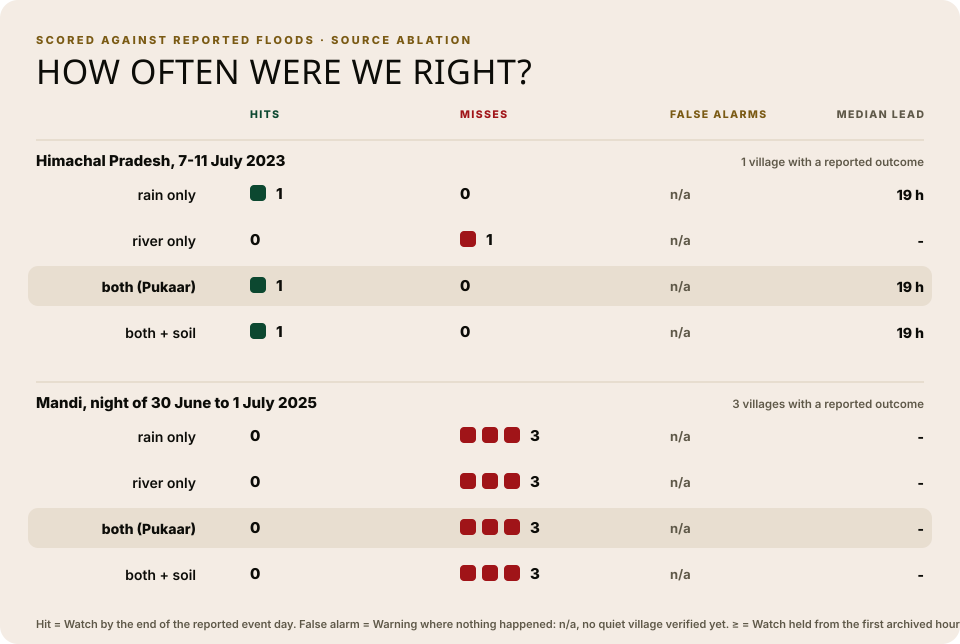

# Scoring the back-test, and a source ablation

`backend/src/Pukaar/scripts/score.py` (`python -m Pukaar.scripts.score`) asks two questions
of the back-test: did the rules warn the villages that were actually hit, and which data
source did the work? It writes `data/scores.json` (copied to `frontend/src/data/scores.json`
for the Impact page); `scripts/build_charts.py` draws `docs/charts/scores.svg` from it.

## Method

The archived hours of each replay scenario (`data/replay/*`) go through the same code as
`scripts/backtest.py`: `risk_rules.assess` on each hourly reading, then the production
hysteresis (`apply_hysteresis`: rise at once, step down after three calm sweeps). No
villager reports and no gauges are used; this scores the forecast data alone.

Three configurations, each through the same hysteresis:

| Configuration | Level each hour |
| --- | --- |
| rain only | `rain_level`: IMD 24 h rain bands (64.5 / 115.6 / 204.5 mm) |
| river only | `river_level`: forecast peak discharge against the village's percentile thresholds |
| both (Pukaar) | the final `level`: the higher of the two, one level up when both reach Watch |

Against `data/ground_truth.json`:

- **hit**: the village was hit, and Watch was reached by the end of the event day (UTC).
- **miss**: the village was hit, and Watch was not reached by then.
- **false alarm**: nothing happened in the village, and Warning was reached at any time.
- **lead hours**: event day 00:00 UTC minus the first Watch, for hits; the table shows the median.
  If Watch was already held at the first archived hour, the lead is a lower bound (marked ≥).

Villages whose truth is `uncertain` are left out of every count.

## Ground truth

Only what public reporting says, checked on 2026-10-11. Where we found no village-specific
report for the dates, the village is `uncertain`; we did not guess.

| Scenario | Village | Truth | Event day | Source |
| --- | --- | --- | --- | --- |
| Himachal, 7-11 July 2023 | Pandoh | event | 2023-07-09 | [Newslaundry, 8 Aug 2023](https://www.newslaundry.com/2023/08/08/our-lives-are-set-back-25-years-in-himachal-a-village-loses-everything-to-floods-2): Beas flood waves crossed Pandoh on 9 and 10 July |
| | Thunag | uncertain | | [Tribune video report](https://www.tribuneindia.com/news/himachal/video-scary-visuals-of-flash-flood-from-mandis-thunag-in-himachal-pradesh-cloudburst-triggers-major-landslide-in-solans-chewa-village-524420), date inside the window not confirmed |
| | Janjehli | uncertain | | none found |
| | Gohar | uncertain | | none found for Gohar itself |
| | Sujanpur | uncertain | | [Tribune](https://www.tribuneindia.com/news/himachal/28-of-five-families-rescued-in-hamipur-423690): Khairi flooding reported for June and August 2023, not 7-11 July |
| Mandi, 30 June-1 July 2025 | Thunag | event | 2025-06-30 | [Down To Earth](https://www.downtoearth.org.in/natural-disasters/cloudbursts-devastate-himachals-mandi-at-least-10-dead-34-missing-after-1900-excess-rain-on-july-1): over 150 homes and shops in Thunag market destroyed |
| | Gohar | event | 2025-06-30 | same: 5 deaths in Gohar subdivision (subdivision level) |
| | Janjehli | event | 2025-06-30 | same: all of Seraj hit, about 10% of the Chail-Janjheli road destroyed |
| | Pandoh | uncertain | | none found |
| | Sujanpur | uncertain | | none found (Hamirpur district) |

## Results

| Scenario | Configuration | Hits | Misses | False alarms | Median lead |
| --- | --- | --- | --- | --- | --- |
| Himachal 2023 (1 village scored) | rain only | 1 | 0 | n/a | 19 h |
| | river only | 1 | 0 | n/a | ≥ 48 h |
| | both (Pukaar) | 1 | 0 | n/a | ≥ 48 h |
| Mandi 2025 (3 villages scored) | rain only | 0 | 3 | n/a | - |
| | river only | 0 | 3 | n/a | - |
| | both (Pukaar) | 0 | 3 | n/a | - |

Read plainly: 1 hit and 3 misses out of 4 scored village-events. In July 2023 the river
forecast flagged Pandoh from the first archived hour, at least 48 hours before the flood
reached it; rain alone flagged it 19 hours before. Combining the sources never did worse
than the better single source here. The 2025 cloudburst was missed by every configuration:
no archived forecast crossed a threshold for the three villages that were hit. That is the
gap a verified villager report is meant to fill.

## Limitations

- **Tiny sample.** Two events, four scored villages. These are counts, not rates.
- **No false-alarm rate yet.** No village is verified as "nothing happened", because an
  absence of reports is not evidence of no damage. Until one is, false alarms are n/a.
- **Archived forecasts are reanalyses.** The historical-forecast and flood archives were
  assembled later; a live system would have seen noisier inputs, so the hit and lead
  numbers are optimistic.
- **Coarse truth.** Some entries are subdivision level (Gohar 2025) or constituency level
  (Janjehli 2025), and the event day is a UTC date, not an hour.
- **Window start.** Pandoh 2023 was already at Watch at the first archived hour, so its lead
  is censored; a longer archive could show a longer or a shorter lead.
- **Forecast data only.** Villager reports and gauges are not in the replay archive, so
  this does not score the full system.
